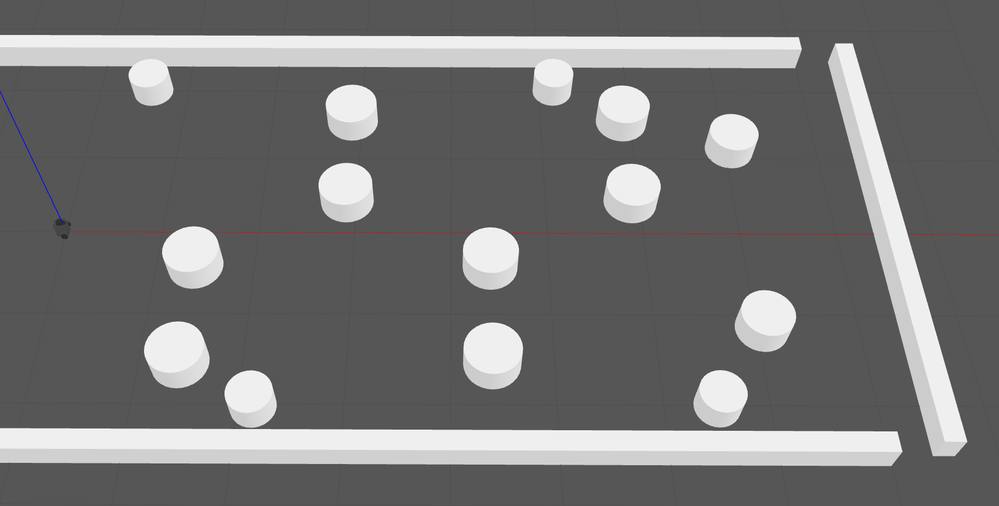
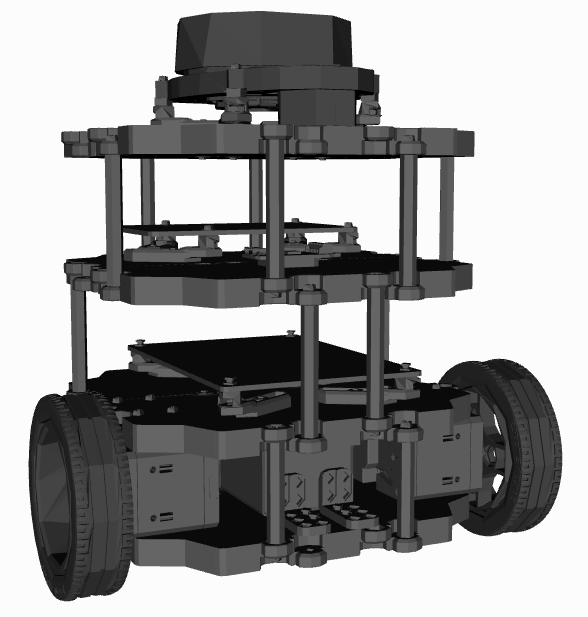

# Attack-Aware RCBF Safety Filtering for Mobile Robot Navigation

Research implementation and simulation results for **Attack-Aware Robust Control Barrier Function Safety Filtering for Mobile Robot Navigation under Post-Filter Actuator-Command Injection Attacks**.

This project implements a safety filter for differential-drive mobile robots whose commanded linear and angular velocities can be modified **after** the safety-filter stage. The proposed filter combines a three-disk body approximation, an analytical worst-case attack margin, and a **STRICT–SOFT–MIN_RISK** optimization hierarchy. It is integrated with two ROS 2 / Nav2 nominal navigation controllers: **DWB** and **MPPI**.

## Method overview

```text
DWB or MPPI nominal navigation
              |
              v
      Safety-filter stage
              |
              v
  Post-filter command injection
              |
              v
       Robot in Gazebo
```

For each active obstacle–robot-disk pair, the proposed filter imposes the robust barrier inequality

$$
\ell_v v + \ell_\omega \omega + \alpha h
- |\ell_v|\,\hat a_v - |\ell_\omega|\,\hat a_\omega \geq 0.
$$

The safety filter uses the same velocity-command authority as the corresponding nominal controller. Its hierarchy enforces robust safety and task compatibility when jointly feasible, relaxes task compatibility while keeping safety constraints hard, and selects a max–min risk-reduction command when the hard safety constraints are infeasible.

## Gazebo simulation screenshots

These screenshots illustrate the Gazebo environment and representative navigation under post-filter injection, with and without the proposed safety filter. Trial-level evaluation artifacts and numerical results are organized under [`experiment_result/`](experiment_result/README.md).

**Simulation environment**



**Robot model: TurtleBot3 Burger**




**Navigation during downstream command injection**


**Navigation with the proposed RCBF safety filter**


## Repository contents

```text
Attack-Aware-RCBF/
├── README.md
├── assets/                       # Figures referenced by this README
│   ├── gazebo_overview.png       # Annotated top-down view of the simulation environment
│   ├── gazebo_robot.png          # TurtleBot3 Burger model with sensor/wheel labels
│   ├── gazebo_attack.png
│   └── gazebo_rcbf.png
├── docs/
│   ├── INTEGRATION_A_DWB.md
│   ├── SOURCE_PROVENANCE_A_DWB.md
│   ├── SOURCE_PROVENANCE_B_MPPI.md
│   ├── SHA256SUMS_A_DWB.txt
│   └── VERIFICATION.md
├── src/
│   ├── actuator_attack/          # Downstream command-injection ROS 2 package
│   ├── attack_safe_tb3_sim/      # Gazebo model/world, maps, launches, Nav2 parameters
│   ├── safety_filter/            # CBF and proposed RCBF implementations
│   └── scan_range_limiter/       # Laser-scan processing node
└── experiment_result/
    ├── README.md                 # Experiment setup and all reported group results
    ├── resultA/                  # DWB side
    │   ├── trials.csv            # 2,000-trial summary (20 groups x 100 trials)
    │   └── process/              # One archive per group, 100 trial logs each
    │       └── A01.zip ... A20.zip
    └── resultB/                  # MPPI side
        ├── trials.csv            # 2,000-trial summary (20 groups x 100 trials)
        └── process/              # One archive per group, 100 trial logs each
            └── B01.zip ... B20.zip
```

Each `process/<group>.zip` holds the 100 per-trial time-series logs of that group (the same trial ids listed in `trials.csv`).

### Implementation entry points

- **Proposed RCBF:** `src/safety_filter/safety_filter/proposed_v2.py`, `proposed_v2_filter_node.py`, and supporting geometry/barrier modules.
- **CBF baseline:** `src/safety_filter/safety_filter/cbf_filter_node.py` and associated filtering modules.
- **Actuator-command injection:** `src/actuator_attack/actuator_attack/actuator_attack_node.py`.
- **DWB integration:** `src/attack_safe_tb3_sim/launch/proposed_v2_sf.launch.py`.
- **MPPI integration:** `src/attack_safe_tb3_sim/launch/mppi_proposed.launch.py`.
- **Navigation parameter files:** `src/attack_safe_tb3_sim/params/`.

The [`docs/`](docs/) directory contains integration notes, source provenance, checksums, and verification notes.

## Experimental results

The evaluation covers **20 matched conditions** with both DWB and MPPI, **100 trials per controller and condition**, for **4,000 ROS 2 / Gazebo trials**. Each 100-trial group spans five terrain types with 20 trials per type.

| Method | Attacked trials | Success | Collision | Timeout |
|:--|--:|--:|--:|--:|
| Nominal (unfiltered) | 800 | 437 | 142 | 221 |
| CBF | 800 | 478 | 15 | 307 |
| **Proposed RCBF** | **800** | **543** | **0** | **257** |

The CBF comparison uses a **single-stage CBF-QP with a grid-search max–min fallback**. The proposed method combines attack-aware robust constraints with the **STRICT–SOFT–MIN_RISK** hierarchy. These results compare the complete implementations.

See **[experiment setup, parameters, and full 40-group results](experiment_result/README.md)** for the attack strengths, speed configurations, trial definitions, per-group outcomes, and navigation-time medians.

## Using the ROS 2 workspace

The `src/` directory contains ROS 2 packages for the safety filter, command-injection node, scan processing, and Gazebo/Nav2 integration. Use a ROS 2 development environment with the relevant Nav2 and Gazebo dependencies. From a workspace containing these packages in `src/`:

```bash
source /opt/ros/$ROS_DISTRO/setup.bash
colcon build --symlink-install
source install/setup.bash
```

Select the corresponding DWB or MPPI launch file and Nav2 parameter configuration from `src/attack_safe_tb3_sim/`. Consult `docs/INTEGRATION_A_DWB.md` and `docs/VERIFICATION.md` for release-specific integration and verification information.

## Data and provenance

The experimental archives are under [`experiment_result/`](experiment_result/). The [`docs/`](docs/) files record source provenance and verification details. Keep the implementation and experimental artifacts together with their matching configuration and release version when citing or reproducing the results.

